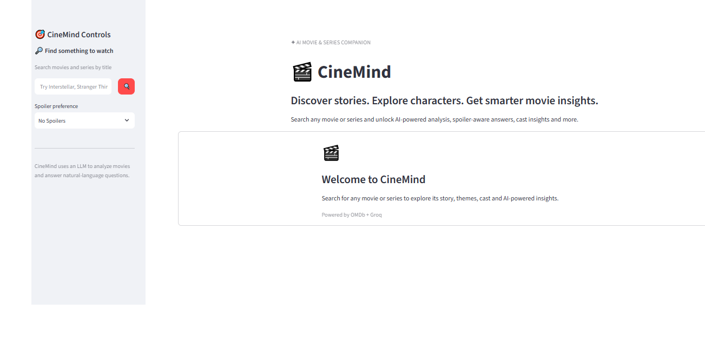
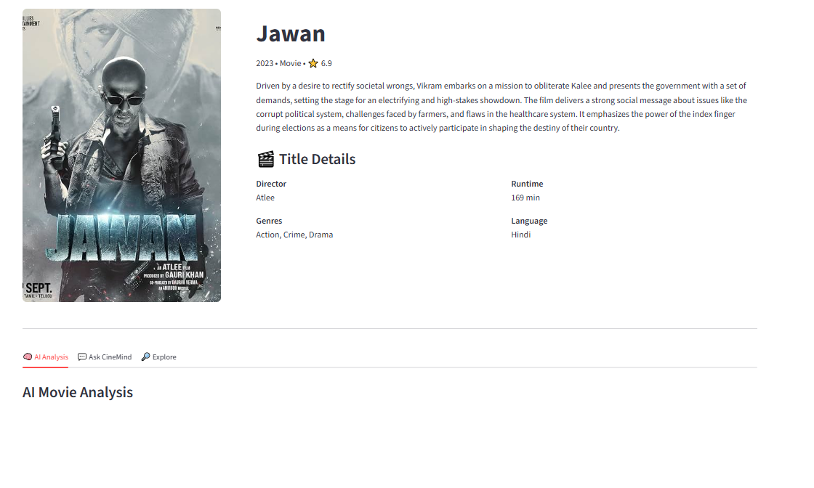
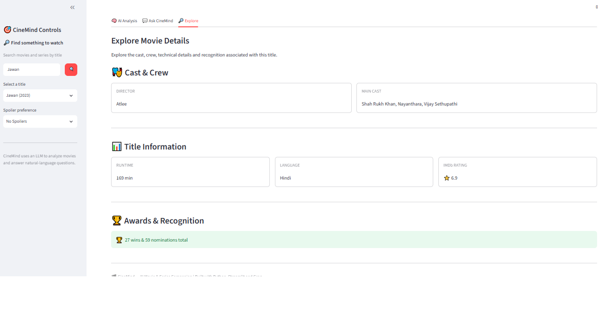

# 🎬 CineMind

### AI-Powered Movie & Series Companion

  <b>Discover stories. Explore characters. Get smarter movie insights.</b>

  CineMind combines real-time movie metadata with generative AI to help users explore movies and TV series through intelligent analysis, spoiler-aware conversations, and rich title insights.

---

## 🌐 Live Application

> 🚀 **Try CineMind:**  
> Add your deployed Streamlit URL here.

---

# 📌 Overview

**CineMind** is an AI-powered movie and series companion built with **Python, Streamlit, OMDb API and Groq-powered LLMs**.

Instead of simply displaying movie metadata, CineMind transforms that information into an interactive exploration experience.

Users can search for a movie or series and then:

- Explore detailed title information
- Generate AI-powered analysis
- Ask natural-language questions
- Control spoiler levels
- Explore cast and crew
- Inspect ratings, runtime, language and awards

The project demonstrates how **external APIs + structured application logic + generative AI** can be combined into a practical user-facing application.

---

# ✨ Key Features

| Feature | Description |
|---|---|
| 🔎 **Title Search** | Search movies and series using natural-language title queries |
| 🌐 **OMDb Integration** | Retrieve dynamic movie and series metadata |
| 🖼️ **Poster & Metadata** | Display posters, ratings, genres, runtime and more |
| 🧠 **AI Analysis** | Generate structured insights about themes, characters and filmmaking |
| 💬 **Ask CineMind** | Ask questions about the selected title |
| 🚫 **Spoiler Control** | Choose between No Spoilers, Mild Spoilers and Full Discussion |
| 🎭 **Cast & Crew** | Explore directors and major cast members |
| 🏆 **Awards** | View available awards and recognition |
| 📺 **Series Support** | Explore TV-series-specific information such as total seasons |
| ⚡ **Interactive UI** | Responsive Streamlit interface designed for exploration |

# 🖥️ Application Preview

## 🏠 Home & Search

  

The CineMind home experience provides a focused search interface where users can quickly discover movies and TV series.

## 🧠 AI Movie Analysis

  

The AI Analysis layer transforms title metadata into structured insights covering themes, storytelling, characters, filmmaking style and viewing appeal.

## 🔍 Explore Title Details

  

The Explore section provides a deeper look into cast, crew, technical information, ratings, awards and series-specific metadata.

# 🧠 How CineMind Works

                    USER
                     │
                     ▼
             ┌───────────────┐
             │  Streamlit UI │
             └───────┬───────┘
                     │
              Search for Title
                     │
                     ▼
             ┌───────────────┐
             │    OMDb API   │
             └───────┬───────┘
                     │
              Movie / Series
                 Metadata
                     │
                     ▼
             ┌───────────────┐
             │ Movie Context │
             │   Builder     │
             └───────┬───────┘
                     │
                     ▼
             ┌───────────────┐
             │ CineMind      │
             │ AI Engine     │
             └───────┬───────┘
                     │
                     ▼
             ┌───────────────┐
             │  Groq LLM     │
             │ GPT-OSS 120B  │
             └───────┬───────┘
                     │
          ┌──────────┴──────────┐
          ▼                     ▼
   AI Movie Analysis      Ask CineMind
          │                     │
          └──────────┬──────────┘
                     ▼
              Intelligent UI

---

# 🏗️ Architecture

CineMind follows a modular architecture that separates the application interface, movie data layer, prompt engineering, and LLM integration.

                         ┌──────────────────────┐
                         │        USER          │
                         └──────────┬───────────┘
                                    │
                                    ▼
                         ┌──────────────────────┐
                         │    Streamlit UI      │
                         │       app.py         │
                         └──────────┬───────────┘
                                    │
                                    ▼
                         ┌──────────────────────┐
                         │      OMDb API        │
                         │ Movie / Series Data  │
                         └──────────┬───────────┘
                                    │
                                    ▼
                         ┌──────────────────────┐
                         │   Movie Context      │
                         │      Builder         │
                         └──────────┬───────────┘
                                    │
                                    ▼
                         ┌──────────────────────┐
                         │   CineMind Engine    │
                         │   Analysis + Q&A     │
                         └──────────┬───────────┘
                                    │
                                    ▼
                         ┌──────────────────────┐
                         │      Groq LLM        │
                         │    GPT-OSS 120B      │
                         └──────────┬───────────┘
                                    │
                         ┌──────────┴───────────┐
                         ▼                      ▼
                  AI Movie Analysis       Ask CineMind
                         │                      │
                         └──────────┬───────────┘
                                    ▼
                         ┌──────────────────────┐
                         │  Intelligent Output  │
                         └──────────────────────┘

### 🛠️ Tech Stack

Application
- Python
- Streamlit
Artificial Intelligence
- Groq API
- GPT-OSS 120B
- Prompt engineering
- Context-aware generation
Data & APIs
- OMDb API
- REST API integration
- JSON data processing
- requests
Development
- python-dotenv
- Git
- GitHub
- Virtual environments

### 👨‍💻 Author
Kshitiz
BCA Student | Data Analytics | AI / GenAI
Interested in building practical applications across:
Data Analytics • Artificial Intelligence • Generative AI • Software Development